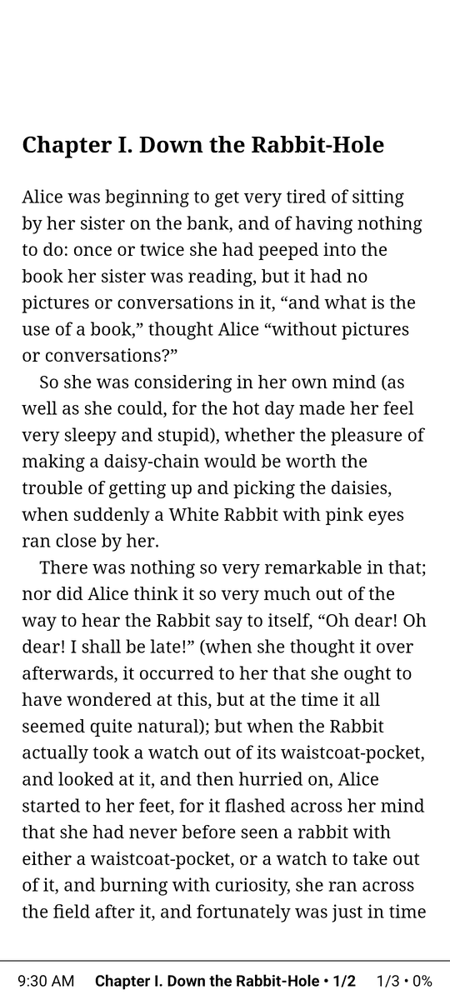
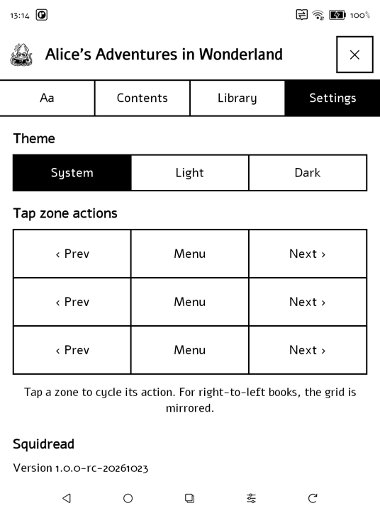

<h1 align="center">Squidread</h1>

	A fast, distraction-free EPUB reader for Android, built for e-ink.

	<a href="https://play.google.com/store/apps/details?id=com.omrilotan.squidread"><strong>Get it on Google Play</strong></a> 
	<a href="https://omrilotan.com/squidread/">Website</a> · <a href="CHANGELOG.md">Changelog</a> · <a href="https://omrilotan.com/squidread/reader/">Web reader</a>

| Distraction-free | Light or dark | Tap zones
| - | - | -
|  |  | 

| Made for e-ink | Turn pages your way |
| --- | --- |
| Pure black and white, light or dark theme. No animations, ripples or shadows. Instant page turns. | Tap, swipe or page buttons. Choose what each tap zone does. Right-to-left books turn the right way. |

### Private, completely

Squidread has no internet permission: **your books and your reading stay on your device.** No accounts, no ads, no analytics. Read the [privacy policy](https://omrilotan.com/squidread/privacy/).

## No Android device?

Try the [web reader](https://omrilotan.com/squidread/reader/) (alpha) in any modern browser. It can be installed as an app.

## Contributing

Squidread is free and open source, released into the public domain. See [CONTRIBUTING.md](CONTRIBUTING.md) to build it or help out.

    · · · 🦑 · · ·

